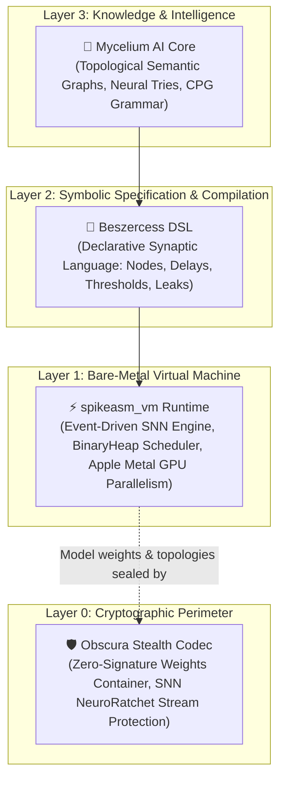
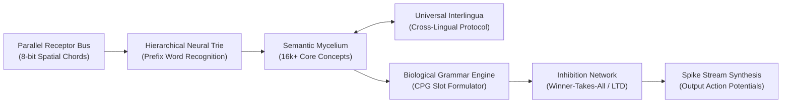

# 🍄 Mycelium AI Core (Bio-Spike Semantic Intelligence)

> **Mycelium** is an alternative artificial intelligence architecture founded upon biologically plausible Spiking Neural Networks (SNN), discrete mycelial topology, and event-driven computing.
> 
> The project represents a fundamental departure from deep learning conventions: **a total elimination of continuous floating-point weight matrices (Float16/32 Transformers/LLMs) in favor of discrete spike events ("ones only, zero zeroes").**

---

## 🏛️ Foundational Stack: The Execution Substrate

To understand how Mycelium operates without matrices, one must understand the three foundational layers upon which it is built:

### 1. `spikeasm_vm` — The Biomorphic Spiking Engine
Traditional neural software relies on PyTorch or CUDA executing millions of dense matrix dot-products ($Y = W \cdot X + b$).  
`spikeasm_vm` is a bare-metal virtual execution environment engineered in Rust. Instead of storing dense multidimensional arrays, it operates as an **asynchronous temporal event engine**:
* **Event-Driven Simulation:** Neurons only consume computing cycles when an electrical impulse (spike) travels through a synapse. Dead silence (the absence of a signal) costs exactly 0% CPU/GPU overhead.
* **Biophysical Accuracy:** Integrates Leaky Integrate-and-Fire (LIF) dynamics, custom refractory periods, membrane potential decay, and real-time Spike-Timing-Dependent Plasticity (STDP / LTD).
* **Massive Parallelism via Apple Metal GPU:** When millions of synapses fire concurrently, `spikeasm_vm` offloads event propagation directly into Metal Compute Shaders (WGSL), utilizing the unified memory architecture of Apple Silicon with zero serialization overhead.

### 2. `Beszercess` — The Synaptic Assembly Language
`Beszercess` is a domain-specific declarative language (DSL) designed to describe neural topologies with biological fidelity:
* Unlike conventional programming languages that express procedural logic (`if/else`, loops), `Beszercess` defines **physical conductivity**: how potential flows from source to target, after what temporal delay, with what synaptic weight, and under what leaky threshold.
* It bridges human-readable semantic structure directly into native bytecode executable by `spikeasm_vm`, providing transparent visibility into every micro-circuit of the artificial brain.

### 3. `Obscura Stealth Codec` — The Cryptographic Perimeter
Why is the [Obscura Stealth Codec](https://github.com/sangaafilum/Obscura) integral to this ecosystem?
* **Zero-Signature Containment:** Classic AI model weights (such as `.safetensors`, `.onnx`, or `.pt`) feature distinct magic headers, making them trivial to intercept, inspect, or reverse-engineer. Obscura encrypts the entire compiled Mycelium synaptic graph into an indistinguishable high-entropy noise stream with zero file headers or recognizable signatures.
* **Neuro-Symmetric Security (NeuroRatchet):** Obscura itself utilizes an evolving SNN stream cipher that continually mutates its internal state with every byte processed. The model weights are secured by the very same biomorphic paradigm that drives the AI itself.
* **Instantaneous Zero-Copy Access (VFS):** Leveraging Obscura's virtual file system index, `spikeasm_vm` can mount and stream gigabytes of synaptic topology directly into memory without full-container decompression.

---

## ⚡ Architectural Manifesto: Why Beyond Conventional LLMs?

Contemporary Large Language Models function as compute-heavy dense matrix probability calculators:
* Billions of floating-point matrix multiplications to generate a single token;
* Massive electrical and thermal dissipation calculating non-informative "zeros" and dead space;
* Inability to achieve immediate, localized on-chip learning without expensive global backpropagation;
* Absence of structural, biological plausibility.

### The Foundational Mycelium Postulate:
> **"Information in the brain is not retained in flat arithmetic matrices — it circulates within a dynamic three-dimensional synaptic topology. The network's topology dictates its computational formula."**

In Mycelium:
1. **Ones Only (Active Spikes):** Inactive state ("0") incurs zero computational expense. Processing units fire strictly when an action potential event arrives.
2. **Spatial Chords:** Elimination of temporal delays during character decoding. An 8-bit parallel receptor bus identifies characters instantaneously at tick $t=0$ with zero pipeline latency.
3. **Hierarchical Neural Trie:** Structured prefix trees prevent synaptic event queue saturation (`EventQueue overflow`).
4. **Topological Semantic Form:** A bidirectional associative graph (16,000+ concept nodes) synthesized directly from comprehensive explanatory lexical corpora.
5. **Central Pattern Generator (CPG):** A biological rhythm oscillator enforcing grammatical order across sequential time slots (`Subject` $\to$ `Verb` $\to$ `Object`).

---

## 🔬 Research Chronology and Verified Milestones

*(Core execution binaries, mathematical weights, and proprietary graph structures are held under confidential research status).*

### Prototyping Stages:

* **Stage 1: Semantic Core Convergence**  
  *Hypothesis confirmed:* Independent lexical nodes converge onto abstract concept nodes, integrating action potentials to exceed firing thresholds without vector dot-products.
* **Stage 2: Neural Trie Scalability**  
  *Bottleneck resolved:* Mitigated `EventQueue overflow` in the VM scheduler when scaling to tens of thousands of words by structuring multi-tier prefix syllables.
* **Stage 3: Spatial Chords over Temporal Morse**  
  *Paradigm shift:* Abandoned serial temporal delays. Replaced with instantaneous 3-of-8 spatial chords across parallel bus receptors.
* **Stage 4: Semantic Form Extraction (Webster Corpus)**  
  *Execution:* Parsed 86,000+ dictionary entries into an associative graph containing 16,165 distinct conceptual nodes.
* **Stage 5: Biological Grammar (Central Pattern Generator)**  
  *Execution:* Constructed an autonomous temporal circuit generating sequential firing windows for syntactic grammatical roles.

---

## 🗺️ Engineering Roadmap

- [x] **Parallel Spatial Alphabet Receptor Bus**
- [x] **Hierarchical Syllable & Word Recognition Trie**
- [x] **Topological Semantic Knowledge Graph**
- [x] **Temporal Syntactic Pattern Generator (CPG)**
- [ ] **Phase 1: Dynamic Stabilization (Inhibition Engine)** — Lateral Inhibition & Winner-Takes-All (WTA) integration via negative synaptic weights (LTD) to suppress hyperactive synonym cascades.
- [ ] **Phase 2: Multi-Lingual Interlingua Bridge** — Mapping Russian, English, and multilingual lexicons onto invariant semantic conceptual nodes.
- [ ] **Phase 3: Hardware Verification on `spikeasm_vm`** — Full compilation of Mycelium bytecode and benchmarking on Apple Silicon Metal compute shaders.
- [ ] **Phase 4: Working Memory Loops & Conversational Protocol** — Recurrent synaptic feedback loops for temporal context retention.

---

## 🔒 Confidentiality & Ecosystem Synergy

This repository serves as the official architectural specification and public development log for **Mycelium AI Core**.
* All low-level engine implementations, synaptic matrices, and mathematical graph equations are proprietary (**Closed Source / Proprietary Research**).
* Built natively to run within the [`spikeasm_vm`](https://github.com/sangaafilum) ecosystem and secured via the [`Obscura Stealth Codec`](https://github.com/sangaafilum/Obscura).
