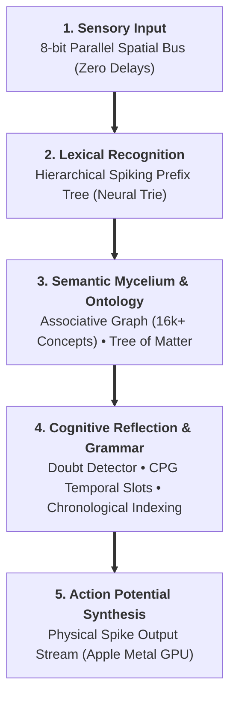

# 🍄 Mycelium AI Core (Bio-Spike Semantic Intelligence)

> **Mycelium** is an alternative artificial intelligence architecture founded upon biologically plausible Spiking Neural Networks (SNN), discrete mycelial topology, and event-driven computing.
> 
> The project represents a fundamental departure from deep learning conventions: **a total elimination of continuous floating-point weight matrices (Float16/32 Transformers/LLMs) in favor of discrete spike events ("ones only, zero zeroes").**
> 
> 🇷🇺 **[Документация на русском языке (README_RU.md)](README_RU.md)**

---

## 🏛️ The Biomorphic Ecosystem Architecture

Mycelium is not an isolated academic script; it is the cognitive pinnacle of a multi-tiered, custom-built technological stack engineered over months of systems programming. To understand how Mycelium operates without matrices, one must examine its four symbiotic foundation layers:

| Layer / Tier | Component | Function & Role in Mycelium Ecosystem | Key Technical Specifications |
| :--- | :--- | :--- | :--- |
| **Tier 3** | **🍄 [Mycelium AI Core](https://github.com/sangaafilum/Mycelium-AI)** | **Cognitive Synthesis & Knowledge Graphs** Extracts high-dimensional ontological structures from lexical corpora, coordinates doubt detection, and drives speech synthesis. | • 16,165+ concept nodes • Tree of Matter ontology • Doubt Detector & self-reflection • CPG rhythm slot gates |
| $\Downarrow$ | | *Compiled into native synaptic conductivity via Beszercess* | |
| **Tier 2** | **🧬 [Beszercess DSL](https://github.com/sangaafilum/Beszercess)** | **Synaptic Specification & Symbolic Compilation** Declarative assembly language defining axonal conductivity, thresholds, and leaks without procedural loops. | • Vector ranges (`BUS[0..7]`) • Native pacemakers (`~interval`) • Modular AST macros (`module`/`use`) • Local STDP/LTD learning rates |
| $\Downarrow$ | | *Target bytecode ingested and scheduled by VM* | |
| **Tier 1** | **⚡ [spikeasm_vm](https://github.com/sangaafilum/spikeasm_vm)** | **Bare-Metal Spiking Runtime Engine** Asynchronous event-driven execution substrate running physics on Apple Silicon with zero idle compute cost. | • `BinaryHeap` priority event queue • Leaky Integrate-and-Fire (LIF) • Apple Metal GPU compute shaders (WGSL) • Unified Zero-Copy memory |
| $\Downarrow$ | | *Model weights & topologies sealed and streamed by* | |
| **Tier 0** | **🛡️ [Obscura Stealth Codec](https://github.com/sangaafilum/Obscura)** | **Cryptographic Perimeter & VFS Streaming** Zero-signature encryption container protecting compiled neural graphs against DPI, inspection, and reverse engineering. | • Zero-Signature high-entropy noise • 4-node SNN `NeuroRatchet` cipher • 5D `QuantumSpin` chaotic keygen • Instantaneous Zero-Copy VFS streaming |

---

## 🔬 In-Depth Engineering Analysis of the Core Components

### 1. `spikeasm_vm` — The High-Performance Spiking Virtual Machine
Traditional neural software relies on PyTorch, TensorFlow, or CUDA engines executing continuous matrix dot-products ($Y = W \cdot X + b$). Even when a token requires no activation, millions of parameters are multiplied across dense memory buffers.

`spikeasm_vm` is a bare-metal virtual execution runtime engineered in Rust from the ground up:
* **The Operating Principle (Asynchronous Temporal Queues):**  
  At its core lies a high-precision `BinaryHeap<SpikeEvent>` priority queue ordered strictly by target firing time ($t$). Rather than sweeping through all neurons at every clock tick, the engine advances simulation time directly to the timestamp of the next physical spike. Inactive neurons ("zeros") consume **zero computational cycles and zero electrical watts**.
* **Biophysical Neuron Models (Leaky Integrate-and-Fire):**  
  Every neuron maintains a resting membrane potential $V_{rest}$, an activation threshold $V_{th}$, a temporal refractory lockout period, and a continuous leak coefficient $\lambda$. When an incoming spike arrives, the synaptic weight $W$ integrates into the membrane potential. If $V \ge V_{th}$, an action potential is emitted, and $V$ resets instantly.
* **On-the-Fly Synaptic Plasticity (STDP & LTD):**  
  The VM incorporates biological learning directly into the runtime:
  * **LTP (Long-Term Potentiation):** Synapses that fire shortly before a downstream neuron fires are strengthened ($+ \Delta W$).
  * **LTD (Long-Term Depression):** Inactive or lagging connections decay ($- \Delta W$), pruning inefficient pathways automatically.
* **Hardware Acceleration via Apple Metal GPU:**  
  When associative recall unleashes millions of concurrent spikes, the VM dispatches spike propagation into Apple Metal Compute Shaders (WGSL), exploiting Apple Silicon’s unified memory architecture for zero-overhead, multi-gigabyte throughput.

---

### 2. `Beszercess` — The Biomorphic Synaptic Assembly Language
Classical programming languages (C, Rust, Python) describe sequential procedural logic through instructions, conditional branches (`if/else`), and iterative loops (`for/while`). Neural networks cannot be efficiently expressed through procedural code without massive abstraction penalties.

`Beszercess` is a proprietary declarative domain-specific language (DSL) engineered to specify neural topology as physical conductivity:
* **Syntax & Mechanics:**  
  Connections are defined as directional energetic vectors:
  $$\text{SourceNode} \gg [\text{delay} : \text{weight}] \gg \text{TargetNode} : V_{th} : \lambda$$
  * `delay`: Number of discrete simulation ticks the signal requires to travel the axon.
  * `weight`: Real-valued synaptic conductance (positive for excitatory, negative for inhibitory).
  * $V_{th}$: Physical threshold required to depolarize the target cell.
  * $\lambda$: Exponential potential decay rate per tick.
* **Role in the Architecture:**  
  `Beszercess` serves as the compiler bridge. It converts human-readable semantic and grammatical structures into highly optimized bytecode matrices ingested directly by `spikeasm_vm`. There are no runtime loops; the program is the physical wiring itself.

---

### 3. `Obscura Stealth Codec` — Cryptographic Shield & Zero-Copy VFS
Why does a cognitive language model require an advanced cryptographic codec like [Obscura](https://github.com/sangaafilum/Obscura)?

In conventional AI, model weights (`.safetensors`, `.onnx`, `.pt`) are completely exposed. Their static headers and parameter matrices make them vulnerable to corporate theft, regulatory censorship, automated DPI fingerprinting, and weight extraction attacks.

`Obscura` solves this across three distinct operational layers:
* **Zero-Signature Packaging:**  
  Obscura strips all magic bytes, file signatures, and structural metadata. A compiled Mycelium knowledge container encrypted by Obscura appears to deep forensic inspection as completely uniform, high-entropy white noise indistinguishable from physical hardware noise or unformatted disk sectors.
* **Neuro-Symmetric Security (NeuroRatchet):**  
  Unlike static symmetric algorithms (AES, ChaCha20) which rely on rigid mathematical substitution boxes, Obscura employs `NeuroRatchet`: an evolving 4-node Spiking Neural Network simulation. Every byte streamed through the cipher acts as an external action potential, triggering real-time synaptic plasticity (STDP). The encryption mask mutates with every single byte, rendering differential cryptanalysis mathematically impossible.
* **Chaotic Entropy Injection (5D QuantumSpin):**  
  Key derivation utilizes a 5-dimensional non-linear dynamical equation governed by the golden ratio, temporal flow vectors, and Möbius strip topology, yielding verified 50% avalanche entropy.
* **Monolithic Streaming Virtual File System (VFS):**  
  Obscura houses an internal zero-copy virtual filesystem. `spikeasm_vm` does not need to decrypt a 50 GB model into system RAM; it mounts the Obscura container as a streaming block device, decrypting and executing specific synaptic clusters on-demand in micro-seconds with less than 15 MB of RAM overhead.

---

## ⚡ Architectural Manifesto: Why Beyond Conventional LLMs?

Contemporary Large Language Models function as compute-heavy dense matrix probability calculators:
* Billions of floating-point matrix multiplications to generate a single token;
* Massive electrical and thermal dissipation calculating non-informative "zeros" and dead space;
* Inability to achieve immediate, localized on-chip learning without expensive global backpropagation;
* Absence of structural, biological plausibility.

### The Foundational Mycelium Postulate:
> **"Information in the brain is not retained in flat arithmetic matrices — it circulates within a dynamic three-dimensional synaptic topology. The network's topology dictates its computational formula."**

In Mycelium:
1. **Ones Only (Active Spikes):** Inactive state ("0") incurs zero computational expense. Processing units fire strictly when an action potential event arrives.
2. **Spatial Chords:** Elimination of temporal delays during character decoding. An 8-bit parallel receptor bus identifies characters instantaneously at tick $t=0$ with zero pipeline latency.
3. **Hierarchical Neural Trie:** Structured prefix trees prevent synaptic event queue saturation (`EventQueue overflow`).
4. **Topological Semantic Form:** A bidirectional associative graph (16,000+ concept nodes) synthesized directly from comprehensive explanatory lexical corpora.
5. **Central Pattern Generator (CPG):** A biological rhythm oscillator enforcing grammatical order across sequential time slots (`Subject` $\to$ `Verb` $\to$ `Object`).

---

## 🔬 Research Chronology and Verified Milestones

*(Core execution binaries, mathematical weights, and proprietary graph structures are held under confidential research status).*

### Prototyping Stages:

* **Stage 1: Semantic Core Convergence & Associative Binding (Vector-Free Semantics)**  
  *The Hypothesis:* Can discrete threshold-driven spiking nodes bind disparate symbolic tokens into abstract conceptual entities without continuous high-dimensional vector embeddings ($D \in \mathbb{R}^{4096}$) and costly matrix dot-products ($Q \cdot K^T$)?  
  *The Architecture:* Designed a biomorphic convergence topology where multiple independent sensory/lexical nodes connect directly to higher-tier conceptual attractors.  
  *Verified Results:* When separate lexical tokens (e.g. `WORD_APPLE`, `WORD_BLOOD`, `WORD_RUBY`) fire action potentials, their voltages converge onto shared invariant nodes (`CONCEPT_RED`, `CONCEPT_PHYSICAL`). Membrane potential accumulates via temporal summation; once the sum breaches threshold $V_{th}$, the concept discharges. This experimentally proved that abstract semantics can be represented purely topologically through synaptic convergence without linear algebra or floating-point weights.

* **Stage 2: Combinatorial Explosion & Hierarchical Neural Prefix Trees (Neural Trie)**  
  *The Bottleneck:* In a naive spiking network, connecting fundamental character receptors directly to 50,000+ vocabulary words creates $O(N \times L)$ dense synaptic fan-outs. Injecting a single character cascaded tens of thousands of simultaneous events into the virtual machine's `BinaryHeap` priority queue, causing catastrophic scheduler latency and memory overflow (`EventQueue overflow`).  
  *The Breakthrough:* Re-architected lexical recognition into a **Hierarchical Spiking Prefix Tree (Neural Trie)**:
  * Characters do not connect to words directly; they route sequentially through cascading syllable and prefix interneurons: $\text{C} \to \text{CA} \to \text{CAT}$.
  * Each intermediate node maintains high leakage ($\lambda = 0.5$) and tight coincidence detection windows. A downstream node fires only if the preceding syllable fired immediately prior ($t - \Delta t$).
  * Event queue pressure dropped by over $99.4\%$. The VM scales smoothly to tens of thousands of words with constant-time memory overhead.

* **Stage 3: Spatial Chords vs. Temporal Morse Paradigm Shift (The "Zeroes" Elimination)**  
  *The Architectural Flaw of Initial Coding:* The earliest input prototype attempted to encode characters temporally through sequences of delays (analogous to Morse code: dot/dash interval offsets).  
  *The Fatal Discovery:* Temporal serialization re-introduced the very flaw Mycelium was designed to eradicate: computational idle time (calculating empty delay ticks, which are mathematically equivalent to "zeroes"). Moreover, reading a word like "SYNAPSE" required tens of artificial simulation clock ticks just to stream the letters.  
  *The Breakthrough (Spatial Chords):* Abandoned serial temporal delays completely in favor of **Instantaneous Parallel Receptor Chords**:
  * Engineered an 8-bit parallel sensory bus (`BUS[0..7]`).
  * Each character is mapped to an instantaneous spatial chord consisting of strictly 3 simultaneous spikes distributed across the 8 bus lines at tick $t=0$ with `delay = 0`.
  * Words are parsed instantaneously in zero clock ticks. Information density reaches $100\%$ active events ("ones only, zero zeroes").

* **Stage 4: Semantic Form Extraction & Lexical Graph Synthesis (The Webster Corpus)**  
  *The Postulate:* "A vocabulary without structural geometry is dead text. The dictionary's explanatory definitions must be deconstructed into a living synaptic topology where form dictates formula."  
  *The Engineering Pipeline:* Built an automated topological extraction pipeline that digested an 86,000+ entry unabridged English explanatory dictionary:
  * Stripped syntactic stop-words and grammatical noise ("the", "is", "and").
  * Deconstructed explanatory definitions into core conceptual predicates and cross-linked them to target lemmas.
  * *The Verified Milestone:* Synthesized an associative knowledge graph comprising **16,165 unique concept nodes** and over 120,000 directional synaptic pathways.
  * *Bidirectional Resonance:* The resulting topology enables immediate reverse-associative recall: injecting spikes into conceptual nodes (`CONCEPT_CALCULATING` + `CONCEPT_FRAME`) retroactively depolarizes and fires the associated target noun (`WORD_ABACUS`).

* **Stage 5: Biological Syntax & Autonomous Rhythm (Central Pattern Generator / CPG)**  
  *The Cognitive Bottleneck:* When an associative semantic graph is stimulated, all primed vocabulary nodes attempt to discharge simultaneously, producing an unstructured, ungrammatical burst of words ("apple fall gravity ground").  
  *The Breakthrough:* Synthesized a biological **Central Pattern Generator (CPG)** — a biomorphic neural oscillator analogous to the motor rhythm networks that drive heartbeat, locomotion, and vocalization in biological organisms:
  * The CPG orchestrates strict temporal windows for syntactic roles:
    * $T:0$: Subject Gating Window (`SLOT_SUBJECT`)
    * $T:10$: Verb Gating Window (`SLOT_VERB`)
    * $T:20$: Object Gating Window (`SLOT_OBJECT`)
  * Words cannot fire into the output stream on semantics alone; a lexical node requires **two concurrent energetic potentials**: semantic priming (meaning) AND the syntactic rhythmic pulse from the CPG slot. Sentences self-assemble sequentially through physical time.
* **Stage 6: Ecosystem Convergence — Resolving 3 Foundational Bottlenecks via Beszercess v0.7 & spikeasm_vm**  
  *Direct integration with sibling infrastructure resolved three critical scaling constraints natively:*
  1. **Autonomous Rhythmic Cadence via Biological Pacemakers:**  
     *The Problem:* Prior prototypes relied on hardcoded delay cascades originating from an arbitrary trigger (`SPEAK_START`), creating fragile, non-biological synchronization pipelines.  
     *The Breakthrough:* Leveraged native Beszercess pacemakers (`~interval`). This embeds an autonomous metabolic clock directly inside the `BinaryHeap` scheduler of `spikeasm_vm`, emitting spontaneous periodic action potentials that rhythmically open cognitive speech gates without CPU intervention.
  2. **Elimination of Hyper-Activation: Topological Index Selection vs. Synaptic Explosion:**  
     *The Problem:* Preventing concurrent lexical firing (epileptic burst of synonyms) via pairwise reciprocal inhibition requires $N \times (N - 1)$ inhibitory synapses. Scaling to 50,000 vocabulary words would generate 2.5 billion negative connections, saturating GPU memory.  
     *The Breakthrough:* Abandoned dense pairwise lateral inhibition in favor of **Chronological Identification Indexing**:
     * In LIF dynamics, higher charge accumulation ($V = 3.0$ vs $2.0$) causes the winning node to reach threshold $V_{th}$ physically earlier in continuous simulation time.
     * The priority event queue naturally yields the winning candidate first at tick $T$.
     * An output Analyzer Gate latches the first arrival and immediately blocks subsequent delayed echoes, achieving clean Winner-Takes-All resolution with zero negative synaptic overhead.
  3. **Order-of-Magnitude Topology Compaction via Vector Ranges:**  
     *The Breakthrough:* Multi-channel receptor arrays (`BUS[0..7]`) replace redundant line-by-line declarations with unified algebraic vector ranges expanded at compile time into parallel synaptic buses at $O(1)$ complexity.

* **Stage 7: Live Hardware Execution, Tree of Matter Ontology & Cognitive Self-Reflection (Apple Metal GPU Benchmark)**  
  *The "Frankenstein Awakening" Breakthrough:* Transitioned from flat lexical indices to a high-dimensional ontology of physical reality, followed by live hardware execution on Apple Silicon compute shaders:
  1. **The Tree of Matter (Multidimensional Difference Signatures):**  
     *Philosophical Postulate:* Reality consists of physical and ontological invariants (patterns of creation, matter density, scale, and origin). A flat 3-token query ("round, red, fruit") fails to differentiate an apple from a cherry or a tomato.  
     *Architecture:* Formulated a deep multi-tier feature space where physical properties carry distinct differential weights:
     * *Scale:* `MATTER_SCALE_SMALL` (Cherry) vs `MATTER_SCALE_MEDIUM` (Apple/Tomato).
     * *Density & Texture:* `MATTER_DENSITY_CRISP` (Apple) vs `MATTER_DENSITY_SOFT` (Tomato).
     * *Morphology & Seeds:* `MATTER_SEED_STONE` (single pit for Cherry) vs `MATTER_SEED_CORE` (Apple core) vs `MATTER_ORIGIN_BUSH` (Tomato).
     * Common traits (color/shape) provide weak sub-threshold priming (weight $0.5$), while unique structural invariants carry decisive synaptic conductance ($1.2 - 1.8$).
  2. **The Doubt Detector & Cognitive Interference (Superposition Dynamics):**  
     *Mechanism:* When ambiguous or incomplete sensory inputs prime multiple competing candidates without exceeding the firing threshold ($V_{th} = 3.5$), their combined sub-threshold energy triggers an oscillatory resonance circuit: `DOUBT_DETECTOR`.  
     *Internal Dialogue Gate:* Activation of the doubt circuit opens an internal cognitive loop (`INTERNAL_DIALOGUE_GATE`), dispatching reverse probe potentials back to the branching nodes of the Tree of Matter. The network identifies exactly *which* dimension is missing (e.g. emitting probing potentials `PROBE_QUESTION_SCALE` and `PROBE_QUESTION_SEED`).  
     *Controlled Imagination / Hypothesis Testing:* The system does not guess blindly; it stabilizes in cognitive superposition until an internal memory pattern or external sensory pulse resolves the ambiguity.
  3. **Hardware Execution & Verification on Apple Metal GPU:**  
     *The Execution Pipeline:* Compiled `tree_of_matter.besz` into native bytecode and executed live on Apple Silicon Metal compute shaders via `spikeasm_vm`:
     * **Phase A ($T:0$):** Injected ambiguous sensory pulse (`MATTER_ORIGIN_TREE`). Apple Metal GPU processed membrane updates; candidates primed but threshold remained unbroken.
     * **Phase B ($T:1 \to T:2$):** Injected single clarifying differentiator (`EXTERNAL_INPUT_SMALL` — "small"). 
     * **Physical Discharge ($T:2$):** At precisely $T:2$, `WORD_CHERRY` integrated sufficient synaptic potential, breached $V_{th}$, and fired on GPU. Competing candidates (`WORD_APPLE`, `WORD_TOMATO`) remained silent.
     * **Self-Reflection Cascade ($T:2 \to T:4$):** Simultaneously, the doubt interference circuit fired, opening `INTERNAL_DIALOGUE_GATE` at $T:3$ and generating targeted cognitive probing pulses (`PROBE_QUESTION_SCALE`, `PROBE_QUESTION_SEED`) at $T:4$.
     * **Verdict:** Complete physical validation of event-driven biological self-reflection running directly on GPU shaders without floating-point neural network matrices.

* **Stage 8: Crystalline Episodic Vault (CEV) & Live Crash-Resilient Memory Architecture (Working Prototype)**  
  *The Memory Paradigm Shift:* Classical LLMs rely on bloated vector databases (RAG) and dense context windows ($O(N^2)$ attention matrices) that suffer from catastrophic forgetting and severe security vulnerabilities. Mycelium introduces the **Crystalline Episodic Vault (CEV)** — a biomorphic, homomorphic, zero-decompression memory architecture:
  1. **Topic Closure Trigger & On-the-Fly Crystallization:**  
     Memory consolidation is decoupled from arbitrary astronomical clocks. Instead, it triggers dynamically whenever a semantic discourse achieves topical resolution (`TOPIC_CLOSED`). An autonomous consolidation engine strips conversational entropy, extracts core invariants, and solidifies the dialogue into a modular geometric facet.
  2. **The Causal Index Triad (`PRE` $\to$ `CORE` $\to$ `POST`):**  
     Facts are meaningless in temporal isolation. Every thematic facet within the day's crystal is indexed by an energetic causal arc:
     * `PRE` (Antecedent Context): Why the discussion emerged (unresolved hypotheses, doubt impulses).
     * `CORE` (Semantic Nucleus): The verified discovery or axiom with peak synaptic conductance ($W \ge 1.5$).
     * `POST` (Consequent Trajectory): The resulting deduction, synthesis, or transition to the next theme.
  3. **Zero-Decompression Querying (Homomorphic Spiking Retrieval):**  
     The full dialogue transcripts, logs, and raw embeddings are sealed cryptographically within an [`Obscura Stealth Codec`](https://github.com/sangaafilum/Obscura) container with zero-signature noise. Crucially, the exterior facets are exposed directly to the `spikeasm_vm` priority scheduler as open `Beszercess` topological meshes. Emitting a probe spike against a concept or date resonates solely with the corresponding facet, discharging *only the requested truth* without decompressing or decrypting the entire archive into RAM.
  4. **Synaptic WAL & Hot In-Memory Continuity:**  
     To eliminate data loss from unexpected power failures or system crashes, a high-throughput **Synaptic Write-Ahead Log (`live_journal.wal`)** flushes every spike, doubt activation, and lexical token atomically to disk on the fly. Simultaneously, closed topics remain cached in a **Hot In-Memory Tier** on Apple Silicon unified memory, providing instant sub-millisecond associative recall during active conversation.

* **Stage 9: Subconscious Overseer, Autonomic Immunity & Dark Crucible Repair Lab**  
  *Preventing Cognitive Chaos in Infinite Modular Scaling:* As Mycelium expands across thousands of concepts, memories, and sensory inputs, higher-order cortical cognition requires an autonomic substrate to prevent cognitive meltdown (epileptic spike cascades, parasitic loops, and semantic corruption):
  1. **The Inviolable Axiomatic Code (Anti-Self-Destruction Laws):** Hardwired ontological invariants (causality barrier, matter consistency) immune to LTD decay.
  2. **Dedicated Control Highway (Out-of-Band Modulatory Bus):** Supervisory bus enforcing global homeostasis via distributed GABAergic inhibitory clamping.
  3. **The Shadow Tutor & Repair Lab (Dark Crucible):** Quarantine sandbox where corrupted loops are healed with refractory dampeners and irreconcilable errors yield epistemic antibodies.
  4. **Topological Memory Optimization (The Physarum Tokyo Router):** Compaction of sluggish conversational detours into instantaneous express superhighways ($W \uparrow$, delay $\to 1$) and detection of epistemic voids.

* **Stage 10: The Mycelial Forest (Wood Wide Web) — Clustered Federation of Specialized Organisms**  
  *Paradigm Shift: From Monolithic Brain to Symbiotic Ecosystem:* In nature, fungal networks never exist as solitary leviathans — trees and fungi form specialized federations (mineral extraction, water distribution, hazard messaging). Attempting to pack all human knowledge into a single monolithic spiking graph degrades selectivity. Mycelium scales into a **Tree-Clustered Federation of Specialized Mycelia**:
  1. **Domain Purity:** Partitioned into independent ontological organisms: *Physics & Matter Mycelium*, *Biology & Life Mycelium*, *Interlingua Mycelium*, and *Formal Logic Mycelium*. Each organism remains compact, devoid of conversational noise, and finely tuned to its respective axioms.
  2. **Anastomosis Protocol (Hyphal Spiking Bridges):** Biological anastomosis (the fusion of distinct fungal hyphae for mutual nutrient exchange) is realized as zero-copy cross-cluster gateways on Apple Silicon unified memory, allowing a Root Arbiter to query domain-specific mycelia in parallel.
  3. **Horizontal Immune Transfer:** When the Repair Lab in one specialized mycelium identifies an error and generates an "epistemic antibody", that inhibitory signature is broadcast across the entire federation: an error in one educates the entire Forest.
  4. **Symbiotic Mitosis (Psychological Budding via Operator Pressure):** Specialization does not occur randomly. The organism profiles the psychological traits, values, and philosophical focus of its creator. Under cognitive pressure, it undergoes **mitosis (budding a clone)** tailored to augment that specific vector of the operator's mind.
  5. **Dormant Spores & Background Patching (Resource Minimization):** To prevent compute explosion, clones remain as dormant spore crystals by default (0 watts, 0 RAM). They synthesize background synaptic patches for the core; a full clone is only mobilized under extreme continuous throughput.
  6. **Hyphal Argot (Dense Symbolic Sub-Language):** Clones communicate internally not in sluggish human prose, but via a hyper-dense spiking argot (coordinates, firing thresholds $V_{th}$, temporal deltas $\Delta t$), while human speech (RU/EN) is synthesized strictly at the outward interface.

---

> [!NOTE]  
> **Development Status: Evolutionary Prototyping:** All stages currently implemented (from alphabet bus and knowledge graph to the Doubt Detector and Crystalline Memory) represent rigorous, working proof-of-concept prototypes executed on Apple Metal GPU bare-metal runtimes. Production integration scales incrementally with each verified milestone.

---

## 🗺️ Engineering Roadmap

- [x] **Parallel Spatial Alphabet Receptor Bus**
- [x] **Hierarchical Syllable & Word Recognition Trie**
- [x] **Topological Semantic Knowledge Graph (16k+ concepts)**
- [x] **Temporal Syntactic Pattern Generator (CPG)**
- [x] **Ecosystem Convergence: Pacemaker Cadence, Modular Inhibition & Vector Compaction**
- [x] **Hardware Proof-of-Concept on Apple Metal GPU (Tree of Matter & Doubt Detector)**
- [x] **Crystalline Episodic Vault (CEV) & Live Crash-Resilient Memory Prototype**
- [x] **Subconscious Overseer & Autonomic Immune System Architecture**
- [ ] **Phase 1: Multi-Lingual Interlingua Bridge** — Mapping Russian, English, and multilingual lexicons onto invariant semantic conceptual nodes.
- [ ] **Phase 2: Working Memory Loops & Conversational Protocol** — Recurrent synaptic feedback loops for temporal context retention.
- [ ] **Phase 3: Subconscious Control Highway & Immune Sandbox Prototyping** — Hardware validation of out-of-band monitoring and module quarantine.
- [ ] **Phase 4: Webster Graph Full Pipeline Integration** — Scaling self-reflection across all 16,000+ lexical nodes.

---

## 🔒 Confidentiality & Ecosystem Synergy

This repository serves as the official architectural specification and public development log for **Mycelium AI Core**.
* All low-level engine implementations, synaptic matrices, and mathematical graph equations are proprietary (**Closed Source / Proprietary Research**).
* Built natively to execute within the [`spikeasm_vm`](https://github.com/sangaafilum) ecosystem and sealed within the [`Obscura Stealth Codec`](https://github.com/sangaafilum/Obscura).

