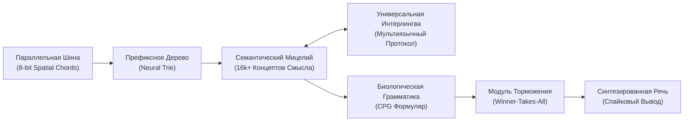

# 🍄 Mycelium AI Core (Bio-Spike Semantic Intelligence)

> **Mycelium** — это альтернативная архитектура искусственного интеллекта, построенная на базе биологически правдоподобных спайковых нейронных сетей (SNN), дискретной топологии мицелия и кастомного DSL `Beszercess` для виртуальной машины `spikeasm_vm`.
> 
> Проект представляет собой радикальный уход от стандартных парадигм глубокого обучения: **полный отказ от матриц весов (Float16/32 Transformers/LLM) в пользу дискретных спайковых событий («только единицы, без нулей»)**.

---

## ⚡ Архитектурный Манифест: Почему не Традиционные LLM?

Современные языковые модели работают по принципу ресурсоемких матричных калькуляторов вероятностей:
* Миллиарды перемножений плотных матриц ради предсказания каждого токена;
* Колоссальные затраты электроэнергии на перемалывание пустоты («нулей»);
* Неспособность к мгновенному локальному дообучению без дорогостоящего обратного распространения ошибки (Backpropagation);
* Отсутствие биологической правдоподобности.

### Главный Постулат Mycelium:
> **«Информация в мозге не хранится в плоских матрицах — она циркулирует в трехмерной топологии синапсов. Форма сети рождает формулу понимания.»**

В Mycelium:
1. **Только Единицы (Active Spikes):** Пустота (0) не вычисляется. Вычислительные ресурсы задействуются исключительно в момент возникновения спайка.
2. **Пространственные Аккорды (Spatial Chords):** Отказ от временных задержек при чтении символов. Параллельная шина рецепторов активирует слова мгновенно на такте $t=0$.
3. **Иерархическое Префиксное Дерево (Neural Trie):** Послойная фильтрация комбинаторного взрыва синапсов.
4. **Семантическая Форма Смыслов:** Двунаправленный ассоциативный граф (16 000+ концептов), построенный на базе толковых словарей.
5. **Центральный Генератор Ритма (CPG):** Биологический синтаксический контур упорядочивания выдачи слов во времени (`Subject` $\to$ `Verb` $\to$ `Object`).

---

## 🔬 Стенограмма Исследований и Полученные Результаты

*(Исходный исполняемый код ядра и специфические математические веса являются закрытой интеллектуальной собственностью и не публикуются).*

### Хронология Прототипирования:

* **Этап 1: Семантическое Ядро (Semantic Convergence)**  
  *Подтверждена гипотеза:* слова сходятся к абстрактным концептам и суммируют потенциал, вызывая пороговую активацию смысла без применения эмбеддинг-векторов.
* **Этап 2: Преодоление Очереди Событий (Neural Trie)**  
  *Решена проблема:* предотвращено переполнение очереди планировщика виртуальной машины (`EventQueue overflow`) при масштабировании словаря до десятков тысяч слов за счет слоговой иерархии.
* **Этап 3: Пространственные Аккорды (Spatial Encoding)**  
  *Отказ от азбуки Морзе:* устранена задержка времени при вводе символов. Буквы кодируются одновременными импульсами по 8-битной шине без задержек.
* **Этап 4: Развертывание Семантической Формы (Webster Corpus)**  
  *Результат:* разобран массив из 86 000+ словарных статей, сформирован граф из 16 165 уникальных смысловых узлов.
* **Этап 5: Биологическая Грамматика (Central Pattern Generator)**  
  *Результат:* синтезирован временной контур, задающий жесткий ритм активации грамматических слотов предложения.

---

## 🗺️ Дорожная Карта Разработки (Roadmap)

- [x] **Пространственная шина распознавания алфавита (Spatial Bus)**
- [x] **Иерархическое префиксное дерево слогов и слов (Trie)**
- [x] **Семантический ассоциативный граф на базе толкового словаря**
- [x] **Грамматический генератор упорядочивания слотов (CPG)**
- [ ] **Фаза 1:** Внедрение локального бокового торможения (Winner-Takes-All / LTD) для предотвращения эпилептической гиперактивации синонимов.
- [ ] **Фаза 2:** Мультиязычный интерлингва-мост (привязка русского и английского лексикона к единым узлам смыслов).
- [ ] **Фаза 3:** Полная компиляция байткода и валидация на движке `spikeasm_vm` с ускорением Apple Metal GPU.
- [ ] **Фаза 4:** Рекуррентные синапсы кратковременной памяти контекста и диалоговый интерфейс.

---

## 🔒 Статус Доступа и Лицензирование

Данный репозиторий представляет собой официальный технический манифест и журнал архитектурных изменений проекта **Mycelium**. 
* Исходный код ядра, топологические формулы и алгоритмы обучения защищены и находятся в статусе **Closed Source / Proprietary Research**.
* Разработано в связке с экосистемой био-виртуальных вычислений и крипто-контейнера [Obscura](https://github.com/sangaafilum/Obscura).
