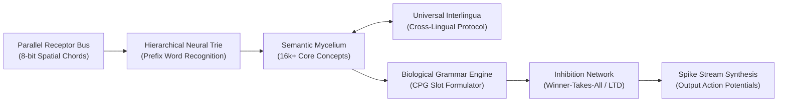

# 🍄 Mycelium AI Core (Bio-Spike Semantic Intelligence)

> **Mycelium** is an alternative artificial intelligence architecture founded upon biologically plausible Spiking Neural Networks (SNN), discrete mycelial topology, and the custom `Beszercess` domain-specific language targeted for the `spikeasm_vm` virtual execution environment.
> 
> The project represents a radical departure from standard deep learning conventions: **a total elimination of continuous weight matrices (Float16/32 Transformers/LLMs) in favor of discrete event-driven spikes ("ones only, zero zeroes").**

---

## ⚡ Architectural Manifesto: Why Beyond Conventional LLMs?

Contemporary Large Language Models function as compute-heavy dense matrix probability calculators:
* Billions of floating-point matrix multiplications to generate a single token;
* Massive electrical and thermal dissipation calculating non-informative "zeros" and dead space;
* Inability to achieve immediate, localized on-chip learning without expensive global backpropagation;
* Absence of structural, biological plausibility.

### The Foundational Mycelium Postulate:
> **"Information in the brain is not retained in flat arithmetic matrices — it circulates within a dynamic three-dimensional synaptic topology. The network's topology dictates its computational formula."**

In Mycelium:
1. **Ones Only (Active Spikes):** Inactive state ("0") incurs zero computational expense. Processing units fire strictly when an action potential event arrives.
2. **Spatial Chords:** Elimination of temporal delays during character decoding. An 8-bit parallel receptor bus identifies characters instantaneously at tick $t=0$ with zero pipeline latency.
3. **Hierarchical Neural Trie:** Structured prefix trees prevent synaptic event queue saturation (`EventQueue overflow`).
4. **Topological Semantic Form:** A bidirectional associative graph (16,000+ concept nodes) synthesized directly from comprehensive explanatory lexical corpora.
5. **Central Pattern Generator (CPG):** A biological rhythm oscillator enforcing grammatical order across sequential time slots (`Subject` $\to$ `Verb` $\to$ `Object`).

---

## 🔬 Research Chronology and Verified Milestones

*(Core execution binaries, mathematical weights, and proprietary graph structures are held under confidential research status).*

### Prototyping Stages:

* **Stage 1: Semantic Core Convergence**  
  *Hypothesis confirmed:* Independent lexical nodes converge onto abstract concept nodes, integrating action potentials to exceed firing thresholds without vector dot-products.
* **Stage 2: Neural Trie Scalability**  
  *Bottleneck resolved:* Mitigated `EventQueue overflow` in the VM scheduler when scaling to tens of thousands of words by structuring multi-tier prefix syllables.
* **Stage 3: Spatial Chords over Temporal Morse**  
  *Paradigm shift:* Abandoned serial temporal delays. Replaced with instantaneous 3-of-8 spatial chords across parallel bus receptors.
* **Stage 4: Semantic Form Extraction (Webster Corpus)**  
  *Execution:* Parsed 86,000+ dictionary entries into an associative graph containing 16,165 distinct conceptual nodes.
* **Stage 5: Biological Grammar (Central Pattern Generator)**  
  *Execution:* Constructed an autonomous temporal circuit generating sequential firing windows for syntactic grammatical roles.

---

## 🗺️ Engineering Roadmap

- [x] **Parallel Spatial Alphabet Receptor Bus**
- [x] **Hierarchical Syllable & Word Recognition Trie**
- [x] **Topological Semantic Knowledge Graph**
- [x] **Temporal Syntactic Pattern Generator (CPG)**
- [ ] **Phase 1:** Lateral Inhibition & Winner-Takes-All (WTA) integration via negative synaptic weights (LTD) to suppress hyperactive synonym cascades.
- [ ] **Phase 2:** Multi-Lingual Interlingua Bridge (mapping Russian, English, and multilingual lexicons onto invariant semantic conceptual nodes).
- [ ] **Phase 3:** Native bytecode compilation and benchmark verification on `spikeasm_vm` leveraging Apple Metal GPU acceleration.
- [ ] **Phase 4:** Recurrent synaptic feedback loops for working context memory and conversational interrogation.

---

## 🔒 Confidentiality & Licensing

This repository serves as the official architectural specification and public development log for **Mycelium AI Core**.
* All low-level engine implementations, synaptic matrices, and mathematical graph equations are proprietary (**Closed Source / Proprietary Research**).
* Developed in synergy with the bio-inspired cryptographic suite [Obscura](https://github.com/sangaafilum/Obscura).
