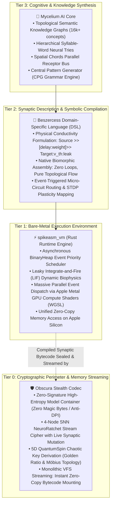
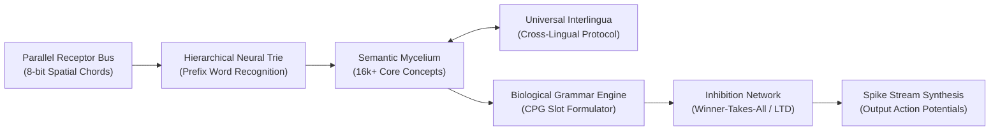

# 🍄 Mycelium AI Core (Bio-Spike Semantic Intelligence)

> **Mycelium** is an alternative artificial intelligence architecture founded upon biologically plausible Spiking Neural Networks (SNN), discrete mycelial topology, and event-driven computing.
> 
> The project represents a fundamental departure from deep learning conventions: **a total elimination of continuous floating-point weight matrices (Float16/32 Transformers/LLMs) in favor of discrete spike events ("ones only, zero zeroes").**
> 
> 🇷🇺 **[Документация на русском языке (README_RU.md)](README_RU.md)**

---

## 🏛️ The Biomorphic Ecosystem Architecture

Mycelium is not an isolated academic script; it is the cognitive pinnacle of a multi-tiered, custom-built technological stack engineered over months of systems programming. To understand how Mycelium operates without matrices, one must examine its four symbiotic foundation layers:

---

## 🔬 In-Depth Engineering Analysis of the Core Components

### 1. `spikeasm_vm` — The High-Performance Spiking Virtual Machine
Traditional neural software relies on PyTorch, TensorFlow, or CUDA engines executing continuous matrix dot-products ($Y = W \cdot X + b$). Even when a token requires no activation, millions of parameters are multiplied across dense memory buffers.

`spikeasm_vm` is a bare-metal virtual execution runtime engineered in Rust from the ground up:
* **The Operating Principle (Asynchronous Temporal Queues):**  
  At its core lies a high-precision `BinaryHeap<SpikeEvent>` priority queue ordered strictly by target firing time ($t$). Rather than sweeping through all neurons at every clock tick, the engine advances simulation time directly to the timestamp of the next physical spike. Inactive neurons ("zeros") consume **zero computational cycles and zero electrical watts**.
* **Biophysical Neuron Models (Leaky Integrate-and-Fire):**  
  Every neuron maintains a resting membrane potential $V_{rest}$, an activation threshold $V_{th}$, a temporal refractory lockout period, and a continuous leak coefficient $\lambda$. When an incoming spike arrives, the synaptic weight $W$ integrates into the membrane potential. If $V \ge V_{th}$, an action potential is emitted, and $V$ resets instantly.
* **On-the-Fly Synaptic Plasticity (STDP & LTD):**  
  The VM incorporates biological learning directly into the runtime:
  * **LTP (Long-Term Potentiation):** Synapses that fire shortly before a downstream neuron fires are strengthened ($+ \Delta W$).
  * **LTD (Long-Term Depression):** Inactive or lagging connections decay ($- \Delta W$), pruning inefficient pathways automatically.
* **Hardware Acceleration via Apple Metal GPU:**  
  When associative recall unleashes millions of concurrent spikes, the VM dispatches spike propagation into Apple Metal Compute Shaders (WGSL), exploiting Apple Silicon’s unified memory architecture for zero-overhead, multi-gigabyte throughput.

---

### 2. `Beszercess` — The Biomorphic Synaptic Assembly Language
Classical programming languages (C, Rust, Python) describe sequential procedural logic through instructions, conditional branches (`if/else`), and iterative loops (`for/while`). Neural networks cannot be efficiently expressed through procedural code without massive abstraction penalties.

`Beszercess` is a proprietary declarative domain-specific language (DSL) engineered to specify neural topology as physical conductivity:
* **Syntax & Mechanics:**  
  Connections are defined as directional energetic vectors:
  $$\text{SourceNode} \gg [\text{delay} : \text{weight}] \gg \text{TargetNode} : V_{th} : \lambda$$
  * `delay`: Number of discrete simulation ticks the signal requires to travel the axon.
  * `weight`: Real-valued synaptic conductance (positive for excitatory, negative for inhibitory).
  * $V_{th}$: Physical threshold required to depolarize the target cell.
  * $\lambda$: Exponential potential decay rate per tick.
* **Role in the Architecture:**  
  `Beszercess` serves as the compiler bridge. It converts human-readable semantic and grammatical structures into highly optimized bytecode matrices ingested directly by `spikeasm_vm`. There are no runtime loops; the program is the physical wiring itself.

---

### 3. `Obscura Stealth Codec` — Cryptographic Shield & Zero-Copy VFS
Why does a cognitive language model require an advanced cryptographic codec like [Obscura](https://github.com/sangaafilum/Obscura)?

In conventional AI, model weights (`.safetensors`, `.onnx`, `.pt`) are completely exposed. Their static headers and parameter matrices make them vulnerable to corporate theft, regulatory censorship, automated DPI fingerprinting, and weight extraction attacks.

`Obscura` solves this across three distinct operational layers:
* **Zero-Signature Packaging:**  
  Obscura strips all magic bytes, file signatures, and structural metadata. A compiled Mycelium knowledge container encrypted by Obscura appears to deep forensic inspection as completely uniform, high-entropy white noise indistinguishable from physical hardware noise or unformatted disk sectors.
* **Neuro-Symmetric Security (NeuroRatchet):**  
  Unlike static symmetric algorithms (AES, ChaCha20) which rely on rigid mathematical substitution boxes, Obscura employs `NeuroRatchet`: an evolving 4-node Spiking Neural Network simulation. Every byte streamed through the cipher acts as an external action potential, triggering real-time synaptic plasticity (STDP). The encryption mask mutates with every single byte, rendering differential cryptanalysis mathematically impossible.
* **Chaotic Entropy Injection (5D QuantumSpin):**  
  Key derivation utilizes a 5-dimensional non-linear dynamical equation governed by the golden ratio, temporal flow vectors, and Möbius strip topology, yielding verified 50% avalanche entropy.
* **Monolithic Streaming Virtual File System (VFS):**  
  Obscura houses an internal zero-copy virtual filesystem. `spikeasm_vm` does not need to decrypt a 50 GB model into system RAM; it mounts the Obscura container as a streaming block device, decrypting and executing specific synaptic clusters on-demand in micro-seconds with less than 15 MB of RAM overhead.

---

## ⚡ Architectural Manifesto: Why Beyond Conventional LLMs?

Contemporary Large Language Models function as compute-heavy dense matrix probability calculators:
* Billions of floating-point matrix multiplications to generate a single token;
* Massive electrical and thermal dissipation calculating non-informative "zeros" and dead space;
* Inability to achieve immediate, localized on-chip learning without expensive global backpropagation;
* Absence of structural, biological plausibility.

### The Foundational Mycelium Postulate:
> **"Information in the brain is not retained in flat arithmetic matrices — it circulates within a dynamic three-dimensional synaptic topology. The network's topology dictates its computational formula."**

In Mycelium:
1. **Ones Only (Active Spikes):** Inactive state ("0") incurs zero computational expense. Processing units fire strictly when an action potential event arrives.
2. **Spatial Chords:** Elimination of temporal delays during character decoding. An 8-bit parallel receptor bus identifies characters instantaneously at tick $t=0$ with zero pipeline latency.
3. **Hierarchical Neural Trie:** Structured prefix trees prevent synaptic event queue saturation (`EventQueue overflow`).
4. **Topological Semantic Form:** A bidirectional associative graph (16,000+ concept nodes) synthesized directly from comprehensive explanatory lexical corpora.
5. **Central Pattern Generator (CPG):** A biological rhythm oscillator enforcing grammatical order across sequential time slots (`Subject` $\to$ `Verb` $\to$ `Object`).

---

## 🔬 Research Chronology and Verified Milestones

*(Core execution binaries, mathematical weights, and proprietary graph structures are held under confidential research status).*

### Prototyping Stages:

* **Stage 1: Semantic Core Convergence**  
  *Hypothesis confirmed:* Independent lexical nodes converge onto abstract concept nodes, integrating action potentials to exceed firing thresholds without vector dot-products.
* **Stage 2: Neural Trie Scalability**  
  *Bottleneck resolved:* Mitigated `EventQueue overflow` in the VM scheduler when scaling to tens of thousands of words by structuring multi-tier prefix syllables.
* **Stage 3: Spatial Chords over Temporal Morse**  
  *Paradigm shift:* Abandoned serial temporal delays. Replaced with instantaneous 3-of-8 spatial chords across parallel bus receptors.
* **Stage 4: Semantic Form Extraction (Webster Corpus)**  
  *Execution:* Parsed 86,000+ dictionary entries into an associative graph containing 16,165 distinct conceptual nodes.
* **Stage 5: Biological Grammar (Central Pattern Generator)**  
  *Execution:* Constructed an autonomous temporal circuit generating sequential firing windows for syntactic grammatical roles.
* **Stage 6: Ecosystem Convergence — Resolving 3 Foundational Bottlenecks via Beszercess v0.7 & spikeasm_vm**  
  *Direct integration with sibling infrastructure resolved three critical scaling constraints natively:*
  1. **Autonomous Rhythmic Cadence via Biological Pacemakers:**  
     *The Problem:* Prior prototypes relied on hardcoded delay cascades originating from an arbitrary trigger (`SPEAK_START`), creating fragile, non-biological synchronization pipelines.  
     *The Breakthrough:* Leveraged native Beszercess pacemakers (`~interval`). This embeds an autonomous metabolic clock directly inside the `BinaryHeap` scheduler of `spikeasm_vm`, emitting spontaneous periodic action potentials that rhythmically open cognitive speech gates without CPU intervention.
  2. **Elimination of Hyper-Activation: Topological Index Selection vs. Synaptic Explosion:**  
     *The Problem:* Preventing concurrent lexical firing (epileptic burst of synonyms) via pairwise reciprocal inhibition requires $N \times (N - 1)$ inhibitory synapses. Scaling to 50,000 vocabulary words would generate 2.5 billion negative connections, saturating GPU memory.  
     *The Breakthrough:* Abandoned dense pairwise lateral inhibition in favor of **Chronological Identification Indexing**:
     * In LIF dynamics, higher charge accumulation ($V = 3.0$ vs $2.0$) causes the winning node to reach threshold $V_{th}$ physically earlier in continuous simulation time.
     * The priority event queue naturally yields the winning candidate first at tick $T$.
     * An output Analyzer Gate latches the first arrival and immediately blocks subsequent delayed echoes, achieving clean Winner-Takes-All resolution with zero negative synaptic overhead.
  3. **Order-of-Magnitude Topology Compaction via Vector Ranges:**  
     *The Breakthrough:* Multi-channel receptor arrays (`BUS[0..7]`) replace redundant line-by-line declarations with unified algebraic vector ranges expanded at compile time into parallel synaptic buses at $O(1)$ complexity.

* **Stage 7: Live Hardware Execution, Tree of Matter Ontology & Cognitive Self-Reflection (Apple Metal GPU Benchmark)**  
  *The "Frankenstein Awakening" Breakthrough:* Transitioned from flat lexical indices to a high-dimensional ontology of physical reality, followed by live hardware execution on Apple Silicon compute shaders:
  1. **The Tree of Matter (Multidimensional Difference Signatures):**  
     *Philosophical Postulate:* Reality consists of physical and ontological invariants (patterns of creation, matter density, scale, and origin). A flat 3-token query ("round, red, fruit") fails to differentiate an apple from a cherry or a tomato.  
     *Architecture:* Formulated a deep multi-tier feature space where physical properties carry distinct differential weights:
     * *Scale:* `MATTER_SCALE_SMALL` (Cherry) vs `MATTER_SCALE_MEDIUM` (Apple/Tomato).
     * *Density & Texture:* `MATTER_DENSITY_CRISP` (Apple) vs `MATTER_DENSITY_SOFT` (Tomato).
     * *Morphology & Seeds:* `MATTER_SEED_STONE` (single pit for Cherry) vs `MATTER_SEED_CORE` (Apple core) vs `MATTER_ORIGIN_BUSH` (Tomato).
     * Common traits (color/shape) provide weak sub-threshold priming (weight $0.5$), while unique structural invariants carry decisive synaptic conductance ($1.2 - 1.8$).
  2. **The Doubt Detector & Cognitive Interference (Superposition Dynamics):**  
     *Mechanism:* When ambiguous or incomplete sensory inputs prime multiple competing candidates without exceeding the firing threshold ($V_{th} = 3.5$), their combined sub-threshold energy triggers an oscillatory resonance circuit: `DOUBT_DETECTOR`.  
     *Internal Dialogue Gate:* Activation of the doubt circuit opens an internal cognitive loop (`INTERNAL_DIALOGUE_GATE`), dispatching reverse probe potentials back to the branching nodes of the Tree of Matter. The network identifies exactly *which* dimension is missing (e.g. emitting probing potentials `PROBE_QUESTION_SCALE` and `PROBE_QUESTION_SEED`).  
     *Controlled Imagination / Hypothesis Testing:* The system does not guess blindly; it stabilizes in cognitive superposition until an internal memory pattern or external sensory pulse resolves the ambiguity.
  3. **Hardware Execution & Verification on Apple Metal GPU:**  
     *The Execution Pipeline:* Compiled `tree_of_matter.besz` into native bytecode and executed live on Apple Silicon Metal compute shaders via `spikeasm_vm`:
     * **Phase A ($T:0$):** Injected ambiguous sensory pulse (`MATTER_ORIGIN_TREE`). Apple Metal GPU processed membrane updates; candidates primed but threshold remained unbroken.
     * **Phase B ($T:1 \to T:2$):** Injected single clarifying differentiator (`EXTERNAL_INPUT_SMALL` — "small"). 
     * **Physical Discharge ($T:2$):** At precisely $T:2$, `WORD_CHERRY` integrated sufficient synaptic potential, breached $V_{th}$, and fired on GPU. Competing candidates (`WORD_APPLE`, `WORD_TOMATO`) remained silent.
     * **Self-Reflection Cascade ($T:2 \to T:4$):** Simultaneously, the doubt interference circuit fired, opening `INTERNAL_DIALOGUE_GATE` at $T:3$ and generating targeted cognitive probing pulses (`PROBE_QUESTION_SCALE`, `PROBE_QUESTION_SEED`) at $T:4$.
     * **Verdict:** Complete physical validation of event-driven biological self-reflection running directly on GPU shaders without floating-point neural network matrices.

---

## 🗺️ Engineering Roadmap

- [x] **Parallel Spatial Alphabet Receptor Bus**
- [x] **Hierarchical Syllable & Word Recognition Trie**
- [x] **Topological Semantic Knowledge Graph (16k+ concepts)**
- [x] **Temporal Syntactic Pattern Generator (CPG)**
- [x] **Ecosystem Convergence: Pacemaker Cadence, Modular Inhibition & Vector Compaction**
- [x] **Hardware Proof-of-Concept on Apple Metal GPU (Tree of Matter & Doubt Detector)**
- [ ] **Phase 1: Multi-Lingual Interlingua Bridge** — Mapping Russian, English, and multilingual lexicons onto invariant semantic conceptual nodes.
- [ ] **Phase 2: Working Memory Loops & Conversational Protocol** — Recurrent synaptic feedback loops for temporal context retention.
- [ ] **Phase 3: Webster Graph Full Pipeline Integration** — Scaling self-reflection across all 16,000+ lexical nodes.

---

## 🔒 Confidentiality & Ecosystem Synergy

This repository serves as the official architectural specification and public development log for **Mycelium AI Core**.
* All low-level engine implementations, synaptic matrices, and mathematical graph equations are proprietary (**Closed Source / Proprietary Research**).
* Built natively to execute within the [`spikeasm_vm`](https://github.com/sangaafilum) ecosystem and sealed within the [`Obscura Stealth Codec`](https://github.com/sangaafilum/Obscura).

