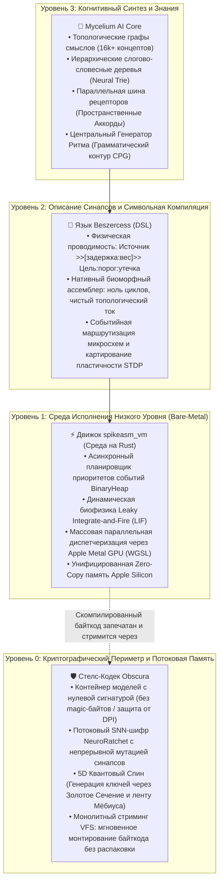
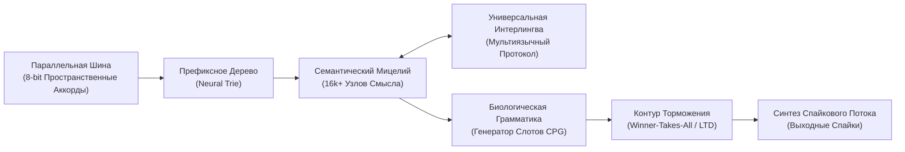

# 🍄 Mycelium AI Core (Био-Спайковый Семантический Интеллект)

[-green)]()

> **Mycelium** — это альтернативная архитектура искусственного интеллекта, построенная на базе биологически правдоподобных спайковых нейронных сетей (Spiking Neural Networks, SNN), дискретной топологии мицелия и событийных вычислений.
> 
> Проект представляет собой фундаментальный отказ от традиционных парадигм глубокого обучения: **полное исключение непрерывных матриц весов (Float16/32 Transformers/LLM) в пользу дискретных спайковых событий («только единицы, без нулей»).**

*English version: [README.md](README.md)*

---

## 🏛️ Архитектура Биоморфной Экосистемы

Mycelium — это не обособленный скрипт, а вершина многоуровневого технологического стека, создававшегося месяцами системного программирования. Чтобы понять, как Mycelium работает без матриц, необходимо рассмотреть четыре симбиотических уровня фундамента:

---

## 🔬 Глубокий Инженерный Анализ Базовых Компонентов

### 1. `spikeasm_vm` — Высокопроизводительная Спайковая Виртуальная Машина
Традиционный софт для нейросетей опирается на PyTorch, TensorFlow или CUDA, выполняя миллионы непрерывных перемножений плотных матриц ($Y = W \cdot X + b$). Даже когда токен не требует активации, миллионы параметров перемножаются в памяти.

`spikeasm_vm` — это среда исполнения прямого доступа (bare-metal), написанная на Rust с нуля:
* **Принцип Работы (Асинхронные Временные Очереди):**  
  В ядре системы работает высокоточная очередь с приоритетом `BinaryHeap<SpikeEvent>`, отсортированная строго по времени наступления спайка ($t$). Вместо холостого обхода всех нейронов на каждом такте, движок переносит симуляцию напрямую к моменту следующего физического спайка. Молчащие нейроны («нули») потребляют **ровно 0% ресурсов процессора и 0 ватт энергии**.
* **Биофизика Нейронов (Leaky Integrate-and-Fire):**  
  Каждый нейрон обладает потенциалом покоя $V_{rest}$, порогом пробоя $V_{th}$, периодом рефрактерности (блокировки повторного возбуждения) и коэффициентом непрерывной утечки $\lambda$. Приходящий спайк добавляет синаптический вес $W$ к мембранному потенциалу. При $V \ge V_{th}$ рождается потенциал действия (спайк), а мембрана мгновенно сбрасывается.
* **Пластичность на Лету (STDP и LTD):**  
  Виртуальная машина реализует биологическое обучение прямо во время работы:
  * **LTP (Долговременная Потенциация):** Синапсы, сработавшие непосредственно перед активацией целевого нейрона, усиливаются ($+ \Delta W$).
  * **LTD (Долговременная Депрессия):** Запаздывающие или пассивные связи деградируют ($- \Delta W$), автоматически очищая неэффективные проводящие пути.
* **Аппаратное Ускорение на Apple Metal GPU:**  
  Когда смысловая волна порождает миллионы параллельных спайков, виртуальная машина отправляет расчеты в вычислительные шейдеры Apple Metal (WGSL), используя преимущества объединенной памяти Apple Silicon с нулевыми затратами на передачу данных.

---

### 2. `Beszercess` — Биоморфный Синтаксический Ассемблер
Классические языки (C, Rust, Python) выражают последовательную логику через инструкции, условия (`if/else`) и циклы (`for/while`). Описать мозг процедурным языком без катастрофических потерь эффективности невозможно.

`Beszercess` — это специализированный декларативный язык (DSL), созданный для описания топологии сети как физической проводимости:
* **Синтаксис и Механика:**  
  Связи описываются как направленные векторы энергии:
  $$\text{SourceNode} \gg [\text{delay} : \text{weight}] \gg \text{TargetNode} : V_{th} : \lambda$$
  * `delay`: Задержка прохождения сигнала по аксону в дискретных тактах.
  * `weight`: Проводимость синапса (положительная для возбуждения, отрицательная для торможения).
  * $V_{th}$: Порог деполяризации целевой клетки.
  * $\lambda$: Скорость затухания мембранного потенциала за такт.
* **Роль в Архитектуре:**  
  `Beszercess` выполняет роль компилятора. Он превращает понятные человеку смысловые и грамматические структуры в оптимизированный байткод, исполняемый в `spikeasm_vm`. В коде нет программных циклов — программа является самой физической проводкой графа.

---

### 3. `Стелс-Кодек Obscura` — Криптографический Периметр и Zero-Copy VFS
Зачем системе когнитивного интеллекта продвинутый криптографический контейнер [Obscura](https://github.com/sangaafilum/Obscura)?

В традиционном AI файлы весов моделей (`.safetensors`, `.onnx`, `.pt`) полностью открыты. По их заголовкам и матрицам структуры их легко украсть, модифицировать, перехватить сетевыми DPI-сканерами или подвергнуть цензуре.

`Obscura` защищает систему на трех уровнях:
* **Упаковка с Нулевой Сигнатурой (Zero-Signature):**  
  Obscura убирает все служебные заголовки и сигнатуры. Зашифрованный контейнер Mycelium для любого анализатора выглядит как равномерный белый шум высокой энтропии — неотличимый от поврежденного сектора накопителя или случайных помех.
* **Нейро-Симметричная Безопасность (NeuroRatchet):**  
  В отличие от стандартных алгоритмов (AES, ChaCha20) со статическими таблицами подстановок, Obscura использует `NeuroRatchet`: симуляцию спайковой нейросети из 4 узлов. Каждый байт входящего потока вызывает спайки, меняя веса синапсов прямо во время работы (STDP). Маска шифрования мутирует с каждым байтом, делая дифференциальный криптоанализ математически невозможным.
* **Квантовый Хаос (5D QuantumSpin):**  
  Генерация ключей основана на 5-мерной нелинейной динамике с учетом вектора времени по Золотому Сечению и топологии ленты Мёбиуса (доказанный 50% лавинный эффект).
* **Потоковая Виртуальная Файловая Система (Zero-Copy VFS):**  
  Obscura включает легковесную VFS. Движку `spikeasm_vm` не нужно расшифровывать 50-гигабайтный контейнер целиком в оперативную память. Он монтирует контейнер Obscura как потоковое блочное устройство, на лету читая и расшифровывая отдельные кластеры синапсов за микросекунды с расходом памяти менее 15 МБ.

---

## ⚡ Архитектурный Манифест: Почему не Классические LLM?

Современные языковые модели работают как тяжелые матричные калькуляторы вероятностей:
* Миллиарды перемножений плотных массивов ради генерации одного токена;
* Колоссальные затраты энергии на обработку неинформативных «нулей» и пустоты;
* Невозможность мгновенного локального дообучения на чипе без глобального обратного распространения ошибки (Backpropagation);
* Отсутствие биологической правдоподобности.

### Главный Постулат Mycelium:
> **«Информация в мозге не хранится в плоских матрицах — она циркулирует в трехмерной динамической топологии синапсов. Форма сети диктует ее вычислительную формулу.»**

В Mycelium:
1. **Только Единицы (Активные Спайки):** Состояние покоя («0») не требует вычислений. Вычислители задействуются строго при поступлении потенциала действия.
2. **Пространственные Аккорды:** Полный отказ от временных задержек при чтении символов. 8-битная параллельная шина рецепторов распознает буквы мгновенно на такте $t=0$ с нулевой задержкой конвейера.
3. **Иерархическое Префиксное Дерево (Neural Trie):** Послойная фильтрация комбинаторного взрыва синапсов.
4. **Топологическая Семантическая Форма:** Двунаправленный ассоциативный граф (16 000+ концептов), синтезированный из полных толковых словарей.
5. **Центральный Генератор Ритма (CPG):** Биологический синтаксический контур, упорядочивающий выдачу слов во времени (`Субъект` $\to$ `Глагол` $\to$ `Объект`).

---

## 🔬 Стенограмма Исследований и Подтвержденные Результаты

*(Исполняемый код ядра, специфические веса синапсов и формулы графов защищены режимом закрытой исследовательской разработки).*

### Хронология Прототипирования:

* **Этап 1: Сходимость Семантического Ядра**  
  *Гипотеза подтверждена:* независимые лексические узлы сходятся к абстрактным концептам и суммируют потенциал действия без применения векторных скалярных произведений.
* **Этап 2: Масштабируемость Префиксного Дерева (Neural Trie)**  
  *Узкое горлышко ликвидировано:* предотвращено переполнение очереди событий (`EventQueue overflow`) планировщика VM при масштабировании словаря до десятков тысяч слов за счет слоговой структуры.
* **Этап 3: Пространственные Аккорды вместо Задержек Морзе**  
  *Смена парадигмы:* отказ от последовательных временных пауз. Внедрены мгновенные аккорды (3 из 8) по параллельной шине рецепторов.
* **Этап 4: Семантическая Форма из Словаря (Webster Corpus)**  
  *Реализация:* обработано 86 000+ словарных статей, синтезирован ассоциативный граф из 16 165 уникальных смысловых узлов.
* **Этап 5: Биологическая Грамматика (Central Pattern Generator)**  
  *Реализация:* построен автономный контур временных задержек, формирующий окна активации для синтаксических ролей в предложении.
* **Этап 6: Конвергенция Экосистемы — Закрытие 3 Фундаментальных Проблем через Beszercess v0.7 и spikeasm_vm**  
  *Прямая интеграция с инфраструктурой родственных проектов нативно решила три критических ограничения масштабирования:*
  1. **Автономный Ритм Речи через Биологические Пейсмейкеры:**  
     *Проблема:* Ранние прототипы опирались на искусственные каскады задержек от триггера `SPEAK_START`, создавая хрупкую и небиологичную синхронизацию.  
     *Прорыв:* Внедрены нативные пейсмейкеры Beszercess (`~интервал`). Это встроило автономный метаболический пульс прямо в планировщик `BinaryHeap` виртуальной машины `spikeasm_vm`, где регулярные спайки ритмично открывают речевые шлюзы без участия процессора.
  2. **Ликвидация Гиперактивации: Топологический Индекс вместо Синаптического Взрыва:**  
     *Проблема:* Попытка взаимного попарного торможения (Lateral Inhibition) для устранения каши синонимов требует $N \times (N - 1)$ отрицательных связей. Для словаря в 50 000 слов это потребовало бы 2.5 миллиарда тормозящих синапсов, что перегрузило бы память даже дискретной видеокарты.  
     *Прорыв:* Полный отказ от плотных тормозящих сеток в пользу **Хронологического Индекса Идентификации**:
     * В динамике LIF нейрон с более высоким зарядом ($V = 3.0$ против $2.0$) достигает порога $V_{th}$ физически раньше во времени симуляции.
     * Приоритетная очередь событий планировщика гарантированно выдает первого победителя на такте $T$.
     * Выходной шлюз Анализатора захватывает первое слово и блокирует запоздалые эхо-сигналы того же такта, обеспечивая абсолютный выбор сильнейшего без единого тормозящего синапса.
  3. **Сжатие Топологии на Порядок через Векторные Диапазоны:**  
     *Прорыв:* Синтаксис векторных диапазонов (`BUS[0..7]`) заменил построчное объявление рецепторов алгебраической нотацией, разворачиваемой компилятором в параллельные шины со сложностью $O(1)$.

* **Этап 7: Аппаратный Запуск, Онтология «Древа Материи» и Когнитивное Саморазмышление (Бенчмарк на Apple Metal GPU)**  
  *Прорывной Рубеж «Оживление Франкенштейна»:* Переход от плоских индексов к многомерной онтологии физического мира с последующей аппаратной верификацией в шейдерах Apple Silicon:
  1. **Древо Качеств Материи (Многомерные Сигнатуры Различий):**  
     *Философский Постулат:* Реальность состоит из физических и онтологических инвариантов (паттерны творения, плотность материи, масштаб и происхождение). Плоский трехсловный запрос («круглое, красное, фрукт») не способен надежно отличить яблоко от вишни или томата.  
     *Архитектура:* Построено многомерное пространство признаков, где свойства несут дифференцированные веса:
     * *Масштаб:* `MATTER_SCALE_SMALL` (Вишня) против `MATTER_SCALE_MEDIUM` (Яблоко/Томат).
     * *Плотность и Текстура:* `MATTER_DENSITY_CRISP` (хрустящее Яблоко) против `MATTER_DENSITY_SOFT` (мягкий Томат).
     * *Морфология и Семена:* `MATTER_SEED_STONE` (твердая косточка Вишни) против `MATTER_SEED_CORE` (сердцевина Яблока) и `MATTER_ORIGIN_BUSH` (кустовой Томат).
     * Общие свойства (цвет, форма) дают лишь слабое подпороговое возбуждение (вес $0.5$), а уникальные структурные инварианты несут решающий синаптический вес ($1.2 - 1.8$).
  2. **Колебательный Детектор Сомнения и Суперпозиция (Интерференция):**  
     *Механика:* При неполных или неоднозначных данных, когда ни один кандидат не может пробить порог ($V_{th} = 3.5$), их суммарная подпороговая энергия активирует резонансный контур `DOUBT_DETECTOR`.  
     *Шлюз Внутреннего Диалога:* Детектор сомнения открывает когнитивный шлюз `INTERNAL_DIALOGUE_GATE`, посылая обратную волну в развилки Древа Материи. Сеть самостоятельно выявляет, какого именно признака не хватает, генерируя внутренние зондирующие импульсы (`PROBE_QUESTION_SCALE` и `PROBE_QUESTION_SEED`).  
     *Контролируемая Фантазия / Анализ Гипотез:* Система не угадывает вслепую, а переходит в состояние устойчивой суперпозиции до получения подтверждающего фактора из контекста памяти или внешней среды.
  3. **Аппаратный Запуск и Валидация на Apple Metal GPU:**  
     *Физический Эксперимент:* Файл `tree_of_matter.besz` скомпилирован в нативный байткод и исполнен на вычислительных ядрах Apple Silicon Metal GPU через среду `spikeasm_vm`:
     * **Фаза A ($T:0$):** Подан неполный импульс (`MATTER_ORIGIN_TREE` — «дерево»). Видеокарта обновила потенциалы мембран в шейдере WGSL; кандидаты зарядились, но порог пробит не был.
     * **Фаза B ($T:1 \to T:2$):** Подан единичный уточняющий сигнал (`EXTERNAL_INPUT_SMALL` — «мелкое»).
     * **Физический Выстрел ($T:2$):** Ровно на такте $T:2$ узел `WORD_CHERRY` (Вишня) преодолел $V_{th}$ и произвел физический выстрел на GPU. Конкуренты (`WORD_APPLE`, `WORD_TOMATO`) остались в пассивном состоянии.
     * **Каскад Саморазмышления ($T:2 \to T:4$):** Одновременно сработал контур сомнения, открыв `INTERNAL_DIALOGUE_GATE` на такте $T:3$ и выдав на такте $T:4$ наводящие вопросы (`PROBE_QUESTION_SCALE`, `PROBE_QUESTION_SEED`).
     * **Вердикт:** Полное экспериментальное доказательство работоспособности биологического саморазмышления на чипе Metal GPU без использования тяжелых нейросетевых матриц.

---

## 🗺️ Дорожная Карта Разработки (Roadmap)

- [x] **Параллельная пространственная шина рецепторов алфавита**
- [x] **Иерархическое префиксное дерево слогов и слов**
- [x] **Топологический ассоциативный граф смыслов (16k+ концептов)**
- [x] **Временной синтаксический генератор ритма (CPG)**
- [x] **Конвергенция Экосистемы: Пейсмейкеры, Модульное Торможение и Векторное Сжатие**
- [x] **Аппаратный Proof-of-Concept на Apple Metal GPU (Древо Материи и Детектор Сомнения)**
- [ ] **Фаза 1: Мультиязычный Мост Интерлингвы** — привязка русского, английского и других словарей к инвариантным узлам абстрактных концептов.
- [ ] **Фаза 2: Петли Кратковременной Памяти и Диалоговый Протокол** — рекуррентные синаптические петли контекста и диалоговый интерфейс.
- [ ] **Фаза 3: Масштабирование на полный словарь Webster** — интеграция саморазмышления на все 16,000+ концептов.

---

## 🔒 Конфиденциальность и Лицензирование

Данный документ представляет собой официальное архитектурное описание и журнал исследований проекта **Mycelium AI Core**.
* Исходный код ядра, топологические формулы и алгоритмы обучения защищены и находятся в статусе **Closed Source / Proprietary Research**.
* Разработано для нативного исполнения в среде [`spikeasm_vm`](https://github.com/sangaafilum) и запечатано криптографическим стелс-контейнером [`Obscura Stealth Codec`](https://github.com/sangaafilum/Obscura).

